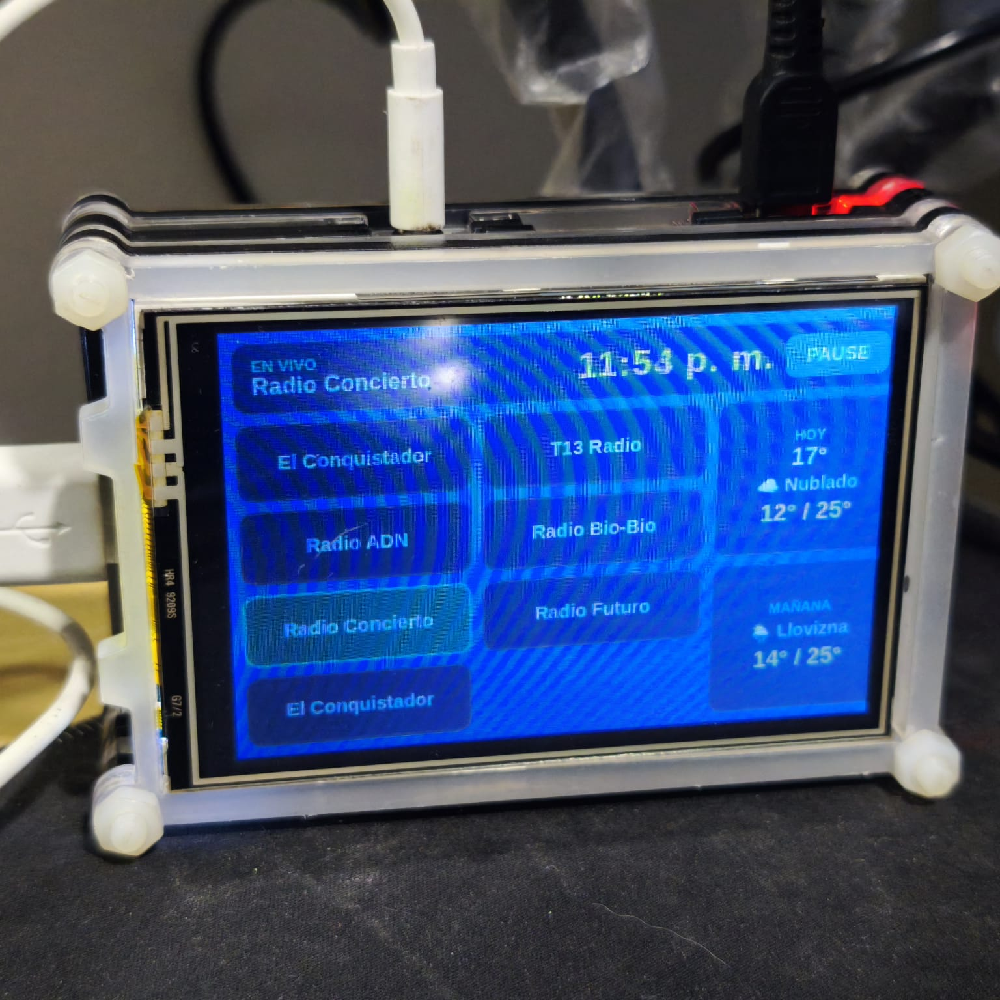
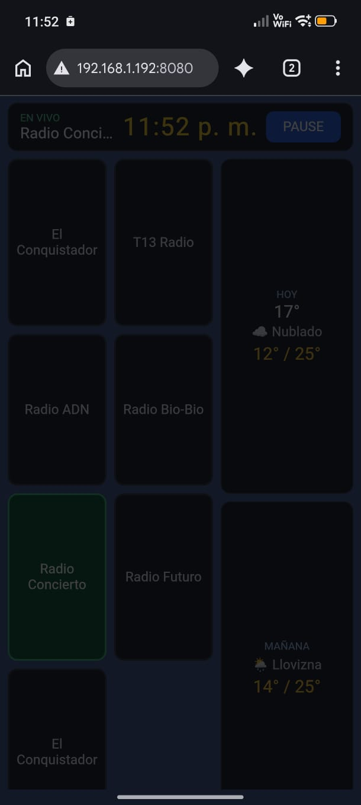

# 📻 RPi Internet Radio & Weather Station

Reproductor autónomo de radio por internet construido sobre **Raspberry Pi 3 Model B** con pantalla **LCD 3.5" (480x320)** en modo kiosco y control remoto desde cualquier navegador en la red local.

> **Nota de Hardware:** La controladora táctil (`XPT2046`) de la pantalla LCD que tengo se encuentra dañada/inoperativa, por lo que la LCD actúa exclusivamente como visor de estado, reloj y clima, mientras que el control de emisoras y reproducción se realiza desde un teléfono celular o PC conectado a la red local (`http://<IP-RASPBERRY>:8080`), los cambios desde el celular se reflejan de inmediato en la raspberry.

---

## ✨ Capturas de la interfaz

| Modo Nocturno |
| Pantalla LCD 3.5" en RPI | Control Web desde Celular |
| :---: | :---: |
|  |  |

---

## ✨ Características Principales

* **Reproducción Autónoma al Encender:** Inicia automáticamente la emisora principal (`El Conquistador`) al arrancar el sistema mediante **MPD (Music Player Daemon)** sin requerir interacción física.
* **Control Remoto vía Web Local:** Interfaz web responsiva accesible desde el navegador del celular en `http://<IP-RASPBERRY>:8080` para cambiar de emisora o pausar/reanudar, reflejando los cambios en la LCD en tiempo real (sincronización cada 2 segundos).
* **Reloj Digital Local:** Sincronizado con zona horaria `America/Santiago`.
* **Pronóstico del Clima en Vivo:** Tarjetas laterales para **Hoy** (temperatura actual, estado y mínima/máxima) y **Mañana** (estado y mínima/máxima) mediante la API pública de **Open-Meteo** (sin necesidad de API Key) con caché local de 30 minutos.
* **Modo Nocturno Automático:** Atenuación de brillo por software (`brightness: 0.25`) activa automáticamente entre las **23:00 y las 07:30**.
* **Modo Kiosco Limpio:** Bloqueo de suspensión de pantalla (`DPMS`), ocultamiento del puntero (`unclutter`) y supresión de burbujas de traducción mediante políticas administradas de Chromium.

---

## 🛠️ Hardware Utilizado

* **Placa:** Raspberry Pi 3 Model B (v1.2).
* **Pantalla:** LCD TFT 3.5" SPI (`480x320`), controlador de video **ILI9486** *(panel táctil XPT2046 averiado, usada en modo solo visualización)*.
* **Salida de Audio:** Jack analógico integrado de 3.5 mm (`ALSA` / `Headphones`).
* **Almacenamiento y Energía:** MicroSD (Raspberry Pi OS Lite Trixie) + fuente 5V 2.5A.

---

## 🏗️ Arquitectura y Stack de Software

```text
+-------------------------------------------------------------------+
|                        Raspberry Pi 3B                            |
|                                                                   |
|  +------------------+      HTTP / JSON       +-----------------+  |
|  |  Chromium Kiosk  | <--------------------- |   Flask Server  |  |
|  | (LCD Solo Visor) |                        |  (Puerto 8080)  |  |
|  +------------------+                        +--------+--------+  |
|                                                       ^           |
|  +------------------+      HTTP / JSON (Control)      |           |
|  |  Celular / PC    | <-------------------------------+           |
|  |   (Red Local)    |                                             |
|  +------------------+                     +-----------+--------+  |
|                                           |                    |  |
|                                           v                    v  |
|                                  +----------------+   +--------+  |
|                                  |  MPD + mpc     |   | Open-  |  |
|                                  | (Audio Stream) |   | Meteo  |  |
|                                  +-------+--------+   +--------+  |
|                                          |                        |
|                                          v                        |
|                                  +----------------+               |
|                                  | ALSA Jack 3.5  |               |
|                                  |  (plughw:1,0)  |               |
|                                  +----------------+               |
+-------------------------------------------------------------------+
```

---

## 🖥️ Configuración e Historia Técnica de la Pantalla LCD 3.5"

Para integrar la pantalla TFT SPI de 3.5" (`480x320`, controlador de video **ILI9486** y controlador táctil **XPT2046 / ADS7846**) sobre **Raspberry Pi OS Lite (Trixie)** sin entorno de escritorio completo, se aplicó la siguiente configuración a nivel de kernel y servidor gráfico Xorg:

### 1. Habilitación de SPI y Device Tree Overlay (`/boot/firmware/config.txt`)
Se descartó el overlay genérico `piscreen` con DRM y se utilizó el overlay específico `tft35a:rotate=270` junto con la resolución forzada a `480x320`:

```ini
[all]
hdmi_force_hotplug=1
dtparam=i2c_arm=on
dtparam=spi=on
enable_uart=1
dtoverlay=tft35a:rotate=270
hdmi_group=2
hdmi_mode=1
hdmi_mode=87
hdmi_cvt 480 320 60 6 0 0 0
hdmi_drive=2
```

### 2. Mapeo del Framebuffer en Xorg (/etc/X11/xorg.conf.d/99-fbdev.conf)
Dado que la salida HDMI corresponde a /dev/fb0 y el driver tft35a crea el dispositivo /dev/fb1, se configuró explícitamente el driver fbdev para dirigir la salida gráfica de X11 hacia la LCD:

```ini
Section "Device"
    Identifier "LCD35"
    Driver "fbdev"
    Option "fbdev" "/dev/fb1"
EndSection
```

### 3. Diagnóstico del Panel Táctil (XPT2046 / ADS7846)
Durante las pruebas de entrada con evtest, xinput y libinput, se comprobó que el controlador resistivo XPT2046 presentaba falla física (sin respuesta de eventos de toque). En lugar de descartar la pantalla, se redefinió la arquitectura:

La LCD quedó dedicada 100% como visor de estado en modo kiosco (Chromium sin bordes a 480x320).

Todo el control de emisoras y reproducción se trasladó al servidor web Flask (:8080), permitiendo operar la radio cómodamente desde cualquier teléfono móvil en la red local.

---

## ⚙️ Instalación de Paquetes, X11 e Interfaz Kiosco

A partir de una instalación limpia de **Raspberry Pi OS Lite (Trixie)** sin entorno de escritorio, se instalaron únicamente los componentes esenciales para el motor de audio (`MPD`), el servidor web (`Flask`), un servidor gráfico mínimo (`Xorg`) y `Chromium` en modo kiosco a pantalla completa.

### 1. Instalación de Paquetes del Sistema (`apt`)
```bash
sudo apt update && sudo apt upgrade -y
sudo apt install -y mpd mpc python3-flask chromium xserver-xorg xinit x11-xserver-utils unclutter fonts-noto-color-emoji
```
### 2. Configuración del Audio y Servicio Web
```bash
sudo tee -a /etc/mpd.conf > /dev/null << 'EOF'
audio_output {
    type            "alsa"
    name            "Jack 3.5mm Raspberry Pi"
    device          "plughw:1,0"
    mixer_type      "software"
}
EOF

sudo systemctl restart mpd
mpc volume 100
sudo timedatectl set-timezone America/Santiago
sudo cp system-config/radio-web.service /etc/systemd/system/radio-web.service
sudo systemctl daemon-reload
sudo systemctl enable --now radio-web.service
```
### 3. Configuración de X11 y Modo Kiosco
```bash
sudo mkdir -p /etc/X11/xorg.conf.d
sudo cp system-config/99-fbdev.conf /etc/X11/xorg.conf.d/99-fbdev.conf
sudo mkdir -p /etc/chromium/policies/managed
sudo cp system-config/no_translate.json /etc/chromium/policies/managed/no_translate.json
cp system-config/xinitrc ~/.xinitrc
cat << 'EOF' >> ~/.bash_profile
if [ -z "$DISPLAY" ] && [ "$(tty)" = "/dev/tty1" ]; then
  startx
fi
EOF
```

---

## 🚫 Bloqueo de Traducción Automática en Chromium Kiosko

En una pantalla de `480x320` sin interacción táctil, el aviso emergente *"¿Quieres traducir esta página?"* de Chromium obstruye parte de la interfaz. Dado que las banderas clásicas (`--disable-features=TranslateUI`) son ignoradas en versiones recientes de Chromium, se aplicó un bloqueo en **tres capas simultáneas**:

### 1. **Política Administrada a Nivel de Sistema (`/etc/chromium/policies/managed/no_translate.json`):**
   Se fuerza la desactivación global del motor de traducción en Chromium:
   ```json
   {
     "TranslateEnabled": false
   }
```

### 2. **Banderas de Arranque en ~/.xinitrc:**
Se inicia Chromium con parámetros explícitos de idioma y supresión de traducción:
   ```text
   chromium --kiosk --lang=es-CL --disable-features=Translate,TranslateUI --noerrdialogs --disable-infobars http://localhost:8080
```

### 3. **Atributos HTML en app.py:**
La etiqueta raíz de la interfaz web declara explícitamente el idioma y el bloqueo de traducción para cualquier navegador cliente:
   ```html
   <html lang="es" translate="no" class="notranslate">
```

---

## 🔧 Operación y Mantenimiento Rápido

* **Reiniciar el servidor de radio:** `sudo systemctl restart radio-web.service`
* **Recargar la pantalla LCD (interrumpe brevemente la señal):** `sudo systemctl restart getty@tty1`
* **Ver estado del servicio en vivo:** `sudo systemctl status radio-web.service`

---

## 📌 Estado del Proyecto

Proyecto operativo y estable funcionando 24/7 como estación de radio y monitor ambiental local.

---

## 📄 Licencia y Uso

Este proyecto es de uso libre para fines personales y educativos. Siéntete libre de adaptarlo a tu propia Raspberry Pi y agregar tus emisoras locales!!.

---

> Proyecto desarrollado y probado sobre **Raspberry Pi OS Lite (Trixie)** para uso doméstico autónomo 24/7.


